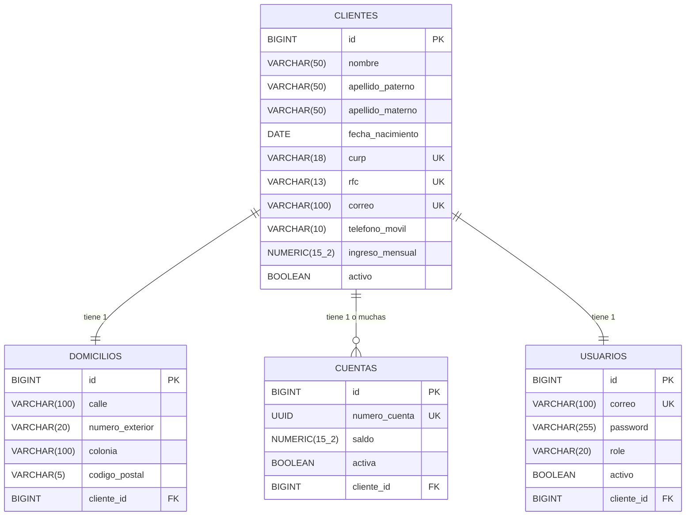

# Microservicio de Usuarios y Onboarding de Clientes

Este microservicio se encarga de la gestión integral del ciclo de vida de los clientes, desde su onboarding inicial (registro de datos personales, fiscales y domicilio) hasta la creación automática de su cuenta financiera y credenciales de acceso seguro.

## Entregables Cumplidos (Rúbrica)

### 1. Diseño de Base de Datos y Optimizaciones
Se aplicaron las mejores prácticas en el diseño relacional y la elección de tipos de datos para asegurar el uso eficiente de memoria e integridad referencial.

#### Diagrama Entidad-Relación (ERD)


#### Modelo de Datos:
* **`clientes`**: Almacena información personal, laboral y de contacto. Uso de `VARCHAR` con límites estrictos (`CURP` a 18, `RFC` a 13) para optimización de almacenamiento. Los campos únicos (`CURP`, `RFC`, `correo`) tienen índices automáticos para agilizar las búsquedas.
* **`cuentas`**: Usa `UUID` para generar identificadores de cuenta matemáticamente únicos y seguros (previniendo enumeración). El saldo se maneja con `Double`/`NUMERIC(15_2)` para operaciones financieras.
* **`usuarios`**: Almacena credenciales de acceso y el Rol (`ADMIN` o `CLIENTE`). La contraseña nunca se guarda en texto plano (cifrada con BCrypt).

### 2. Validaciones Implementadas (Reglas de Negocio)
Se implementó un sistema dual de validación (Nivel Entity/DTO y Nivel Servicio):
- **Validaciones de Formato:** Uso de expresiones regulares (`@Pattern`) para validar el CURP, el RFC, el correo y contraseñas fuertes.
- **Validaciones Transaccionales (Pagos y Recargas):** Al pagar o recargar, el sistema valida que el **monto sea mayor a 0** (previniendo hackeos lógicos con números negativos). También verifica saldo insuficiente al pagar.
- **Validación de Cuentas Inactivas:** Si un cliente se da de baja, el sistema arroja `CuentaInactivaException` e impide más transacciones (403 Forbidden).
- **Baja Lógica:** Se implementó el borrado lógico; en lugar de ejecutar un `DELETE` físico, se inhabilita el Cliente, su Usuario y su Cuenta bancaria en cascada.

### 3. Excepciones Personalizadas
- `ClienteYaRegistradoException` (409 Conflict)
- `CurpDuplicadaException`, `RfcDuplicadoException`, `CorreoDuplicadoException` (409 Conflict)
- `ContrasenaInvalidaException`, Spring Validation (400 Bad Request)
- `CuentaInactivaException` (403 Forbidden)
- `ClienteNoEncontradoException` (404 Not Found)

---

## 🚀 Endpoints de la API REST (Sin @PathVariable ni @RequestParam)

El microservicio cumple estrictamente con la especificación técnica de la rúbrica:
1. **Cero `@PathVariable` y cero `@RequestParam`**: Toda la información y criterios de búsqueda se reciben en el cuerpo JSON de la petición (`@RequestBody`) utilizando objetos **Request DTO** con validaciones declaradas (`@Valid`).
2. **Cero entidades JPA en controladores**: Las entidades nunca se reciben ni se devuelven directamente; se utilizan exclusivamente **Request DTOs** y **Response DTOs** envueltos en la estructura uniforme `ApiResponse<T>`.
3. **Manejo Centralizado de Excepciones**: Implementado mediante `@RestControllerAdvice` en `GlobalExceptionHandler`, retornando estructuras `ErrorResponse` detalladas sin exponer trazas técnicas ni consultas SQL.
4. **Búsquedas Dinámicas Combinadas**: Implementadas mediante un único endpoint de consulta con Spring Data JPA Specifications (`JpaSpecificationExecutor`).

### 1. Administración de Usuarios (`/api/usuarios`) - Solo `ADMIN`
* `POST /api/usuarios`: Registra un nuevo usuario (`UsuarioCreateRequest` ➔ `UsuarioResponse`, HTTP 201 Created).
* `PUT /api/usuarios`: Actualiza datos de un usuario impidiendo la modificación de campos del servidor (`UsuarioUpdateRequest` ➔ `UsuarioResponse`, HTTP 200 OK).
* `DELETE /api/usuarios`: Realiza la baja lógica del usuario (`UsuarioDeleteRequest` con ID en el body, HTTP 200 OK).
* `POST /api/usuarios/buscar`: **Único endpoint de búsqueda dinámica**. Permite filtrar y combinar criterios (`id`, `correo`, `role`, `activo`, `fechaInicio`, `fechaFin`) en `UsuarioFiltroRequest` ➔ `List<UsuarioResponse>`.
* `GET /api/usuarios/me`: Consulta el perfil del usuario autenticado en sesión.

### 2. Clientes (`/api/clientes`)
* `POST /api/clientes`: (Público) Registra un cliente con su cuenta y usuario (`ClienteRegistroRequest` ➔ `ClienteResponse`, HTTP 201 Created).
* `POST /api/clientes/buscar`: (`ADMIN`) **Único endpoint de búsqueda dinámica de clientes**. Permite combinar filtros (`id`, `curp`, `rfc`, `correo`, `numeroCuenta`, `activo`, fechas) en `ClienteFiltroRequest` ➔ `List<ClienteResponse>`.
* `PUT /api/clientes`: (`ADMIN`) Actualiza información de un cliente (`ClienteUpdateRequest` ➔ `ClienteResponse`, HTTP 200 OK).
* `DELETE /api/clientes`: (`ADMIN`) Baja lógica del cliente (`ClienteDeleteRequest`, HTTP 200 OK).

### 3. Cuentas Financieras (`/api/cuentas`) - Solo `ADMIN`
* `POST /api/cuentas/consultar`: Consulta información de cuenta por `CuentaConsultaRequest` (`numeroCuenta`).
* `GET /api/cuentas/activas`: Lista todas las cuentas activas.
* `POST /api/cuentas/saldo`: Consulta de saldo por `CuentaConsultaRequest`.
* `POST /api/cuentas/pagar`: Realiza un pago validando saldo y estatus (`TransaccionRequest`).
* `POST /api/cuentas/recargar`: Realiza una recarga validando estatus (`TransaccionRequest`).
* `POST /api/cuentas/historial`: Consulta transacciones por `CuentaConsultaRequest`.

### 4. Autoservicio de Clientes (`/api/me`) - `CLIENTE` / `ADMIN`
* `GET /api/me/perfil`: Consulta el perfil propio a partir del token JWT (`ClienteResponse`).
* `PATCH /api/me/perfil`: Actualización de datos propios mediante DTO.
* `POST /api/me/reconocimiento-facial`: Verificación biométrica con `MultipartFile`.

---

## 🌐 Despliegue en la Nube (Render)
El servicio se encuentra completamente desplegado y operativo en la nube:
* **Swagger UI en Producción:** [https://gestopago-api-6l9t.onrender.com/swagger-ui/index.html](https://gestopago-api-6l9t.onrender.com/swagger-ui/index.html)

---

## 💾 Script de Base de Datos (DDL)
Aunque Spring Boot (Hibernate) genera automáticamente las tablas gracias a la propiedad `ddl-auto=update`, aquí se adjunta el script DDL equivalente para la creación manual de la base de datos optimizada:

```sql
CREATE DATABASE gestopago_usuarios;

\c gestopago_usuarios;

CREATE TABLE clientes (
    id BIGSERIAL PRIMARY KEY,
    nombre VARCHAR(50) NOT NULL,
    segundo_nombre VARCHAR(50),
    apellido_paterno VARCHAR(50) NOT NULL,
    apellido_materno VARCHAR(50) NOT NULL,
    fecha_nacimiento DATE NOT NULL,
    curp VARCHAR(18) UNIQUE NOT NULL,
    rfc VARCHAR(13) UNIQUE NOT NULL,
    sexo VARCHAR(20),
    nacionalidad VARCHAR(50),
    estado_civil VARCHAR(50),
    correo VARCHAR(100) UNIQUE NOT NULL,
    telefono_movil VARCHAR(10) NOT NULL,
    telefono_alternativo VARCHAR(10),
    ocupacion VARCHAR(100),
    empresa VARCHAR(100),
    ingreso_mensual NUMERIC(15,2) CHECK (ingreso_mensual > 0),
    activo BOOLEAN DEFAULT TRUE,
    fecha_creacion TIMESTAMP DEFAULT CURRENT_TIMESTAMP,
    fecha_actualizacion TIMESTAMP DEFAULT CURRENT_TIMESTAMP
);

CREATE TABLE domicilios (
    id BIGSERIAL PRIMARY KEY,
    calle VARCHAR(100) NOT NULL,
    numero_exterior VARCHAR(20) NOT NULL,
    numero_interior VARCHAR(20),
    colonia VARCHAR(100) NOT NULL,
    municipio VARCHAR(100) NOT NULL,
    estado VARCHAR(100) NOT NULL,
    codigo_postal VARCHAR(5) NOT NULL,
    pais VARCHAR(50) NOT NULL,
    cliente_id BIGINT UNIQUE REFERENCES clientes(id)
);

CREATE TABLE cuentas (
    id BIGSERIAL PRIMARY KEY,
    numero_cuenta UUID UNIQUE NOT NULL,
    saldo NUMERIC(15,2) NOT NULL CHECK (saldo >= 0),
    activa BOOLEAN DEFAULT TRUE,
    cliente_id BIGINT REFERENCES clientes(id)
);

CREATE TABLE usuarios (
    id BIGSERIAL PRIMARY KEY,
    correo VARCHAR(100) UNIQUE NOT NULL,
    password VARCHAR(255) NOT NULL,
    role VARCHAR(20) NOT NULL,
    activo BOOLEAN DEFAULT TRUE,
    cliente_id BIGINT UNIQUE REFERENCES clientes(id),
    fecha_creacion TIMESTAMP DEFAULT CURRENT_TIMESTAMP,
    fecha_actualizacion TIMESTAMP DEFAULT CURRENT_TIMESTAMP
);

-- Índices para optimización de consultas frecuentes
CREATE INDEX idx_cliente_curp ON clientes(curp);
CREATE INDEX idx_cliente_rfc ON clientes(rfc);
CREATE INDEX idx_cuenta_numero ON cuentas(numero_cuenta);
```

---

## 🛠️ Instrucciones de Ejecución y Pruebas
1. Ejecutar el proyecto: `./mvnw spring-boot:run`
2. Abrir **Swagger OpenAPI**: `http://localhost:8080/swagger-ui/index.html`
3. Crear un cliente -> Iniciar sesión -> Copiar Token JWT -> Pegarlo en el botón verde **Authorize**.
